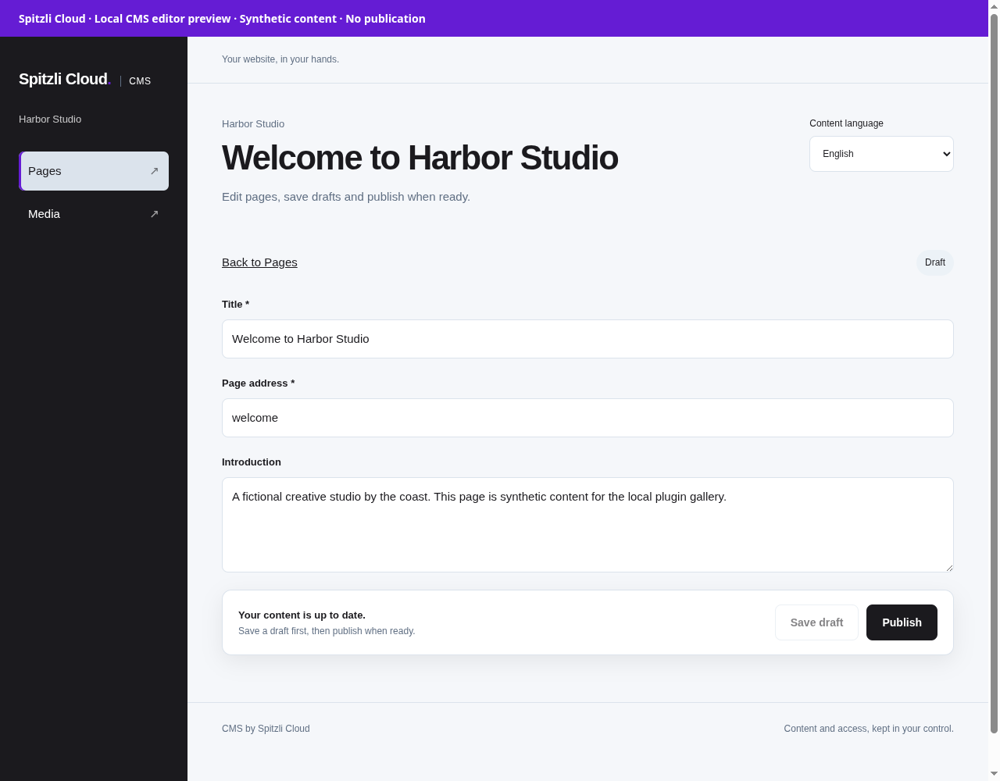
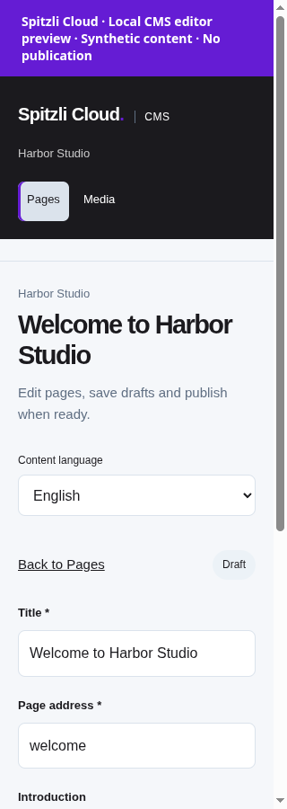

# Managed CMS

Edit website content in Spitzli Cloud while each project keeps its own CMS application and data.

## What you can do

Create independent website CMS instances through the hosting integration, then manage pages, drafts and media through the native CMS editor.

## Setup and access

Requires an operator-installed protocol-v1 plugin, apps service, a scoped CMS HTTP binding and separately deployed CMS instance. The plugin image and per-project CMS application image are distinct.

## Data and security

Core authorizes the project and the bridge enforces CMS permissions. Draft editing and publication are separate. Preserve each instance database, retained media and bridge credentials; no cross-project shared content store is introduced.

## Status and limits

Beta. Registry admission, runtime binding and database/image/backup acceptance must be verified separately. Existing integration fixtures use disposable data; source publication is not customer activation.

Catalog publication does not activate the plugin, enable public signup or grant
access to any customer resource. A new presentation release must use a new version;
previously signed releases and their assets stay immutable.

## Gallery

Actual CMS editor with synthetic draft content and a read-only fixture transport. No content was saved or published.

## Catalog source

`.tabularium` is the complete catalog-refresh source. It retains the immutable
runtime image and full protocol/access contract of the currently released
`0.1.0-alpha.1` and adds the prepared presentation assets. Refresh it only from a
reviewed immutable source commit. This does not replace signed release assets
or activate the runtime.

The Spitzli Cloud CMS branding in this source checkout and gallery requires
a new runtime release. The existing `0.1.0-alpha.1` image retained in
`.tabularium` does not contain that change.

## Technical reference

The retained implementation notes below include platform integration procedures.
Commands referring to Core, `tools/` or `apps/console` require the [platform source
checkout](https://github.com/spitzli/webdock); they are not standalone setup steps.

Independent source workspace for the existing managed-cms TypeScript protocol-v1
plugin and its separate per-project CMS application. This is not a Rust v2 release.

Run `bun install --ignore-scripts` once and commit the generated `bun.lock`.
Thereafter use `bun install --frozen-lockfile --ignore-scripts`, `bun run check`,
`bun run test`, and `bun run build`. No production credentials are needed to build.
Docker contexts are this repository root with the respective component Dockerfile.
Builds must run locally/in verified EU infrastructure, following owner policy.

The plugin and CMS instance are separate images. Generate a plugin manifest with
`bun extensions/managed-cms/manifest.ts <real-image@sha256:digest> <output.json>`.
Publication, registry signatures, image access and installer compatibility must
be verified separately; this export does not publish or activate anything.

Only the eight listed support packages are included. Core, provider credentials,
runtime state and environment files are excluded. The upstream plugin image-smoke
requires the Core installer, and the bridge PostgreSQL test requires the website
migration: those platform tests are deliberately withheld. Database/image/backup
acceptance remains explicit and uses disposable local fixtures only. Existing
per-project CMS database and retained media must never be reset during export.

See component READMEs for runtime contracts. They retain historical Core-relative
operator links; those paths are not part of this independent repository.

## Independent source and release

Source: https://github.com/spitzli/cloud-plugin-managed-cms. The Blacksmith GitHub App is installed for the exact 16 Spitzli platform, plugin and SDK repositories. The configured and observed region is `us-west`, under the owner’s EU-only exception for Spitzli’s own GitHub CI. The official managed-builder probe passed with `nofallback: true`. These prepared workflows use only Blacksmith; actual per-repository source checks and publication of the regular workflows remain pending. Provider and customer credentials are not used for source checks, and no builder fallback is allowed. The root Dockerfile `check` target runs typechecking, unit tests and complete
production builds of both components. Tests needing a real database or deployed
image remain explicit opt-in acceptance checks; no tenant data is used by CI.

A signed `v<version>` source tag builds/pushes separate images:
`ghcr.io/spitzli/cloud-plugin-managed-cms` and
`ghcr.io/spitzli/cloud-plugin-managed-cms-instance`, each with the actual source
repository/revision label. Release assets include identical TS-v1 `tabularium.json`
and `managed-cms-universal.json`, SHA-256 checksums and a separate immutable CMS
instance image binding. The release does not call the registry API, invent a
registry signature or activate any customer instance. Registry admission is a separate step; verify the actual signed receipt
before installing a release.

`export-lock.json` preserves the initial export/standalone source snapshots; later
changes are recorded by verified signed Git commits and release image digests.
The two large durable-transfer integration fixtures have explicit 60-second
budgets for their real sequential fsync workload; their assertions, chunk sizes
and retained-receipt capacities remain unchanged.
